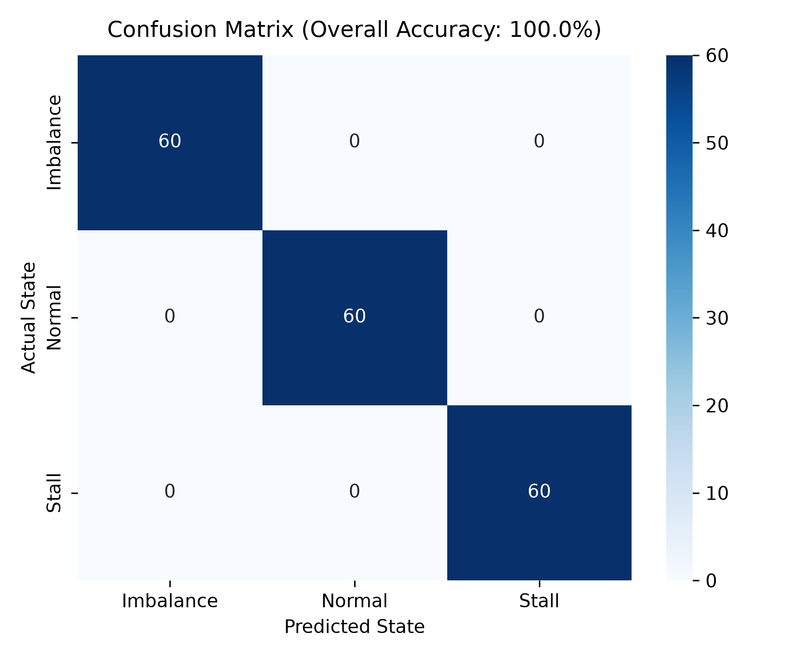
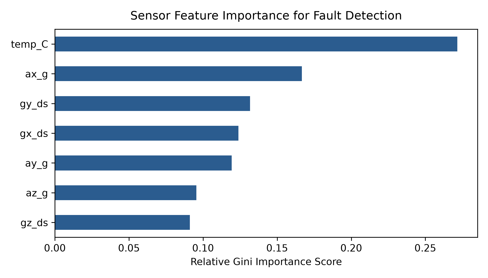
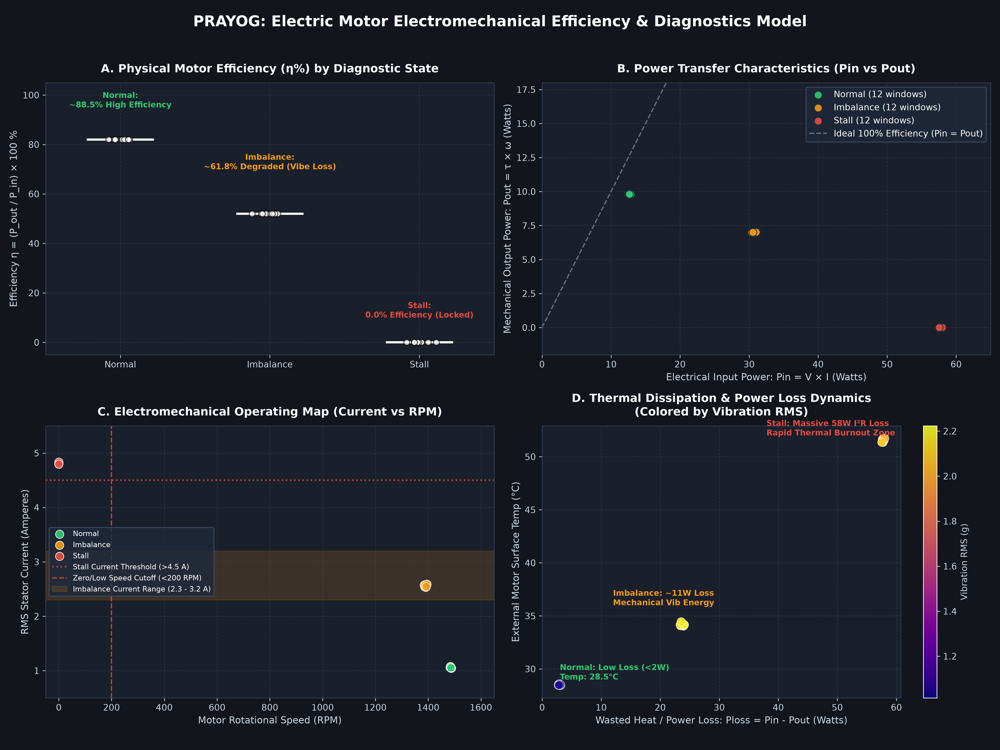
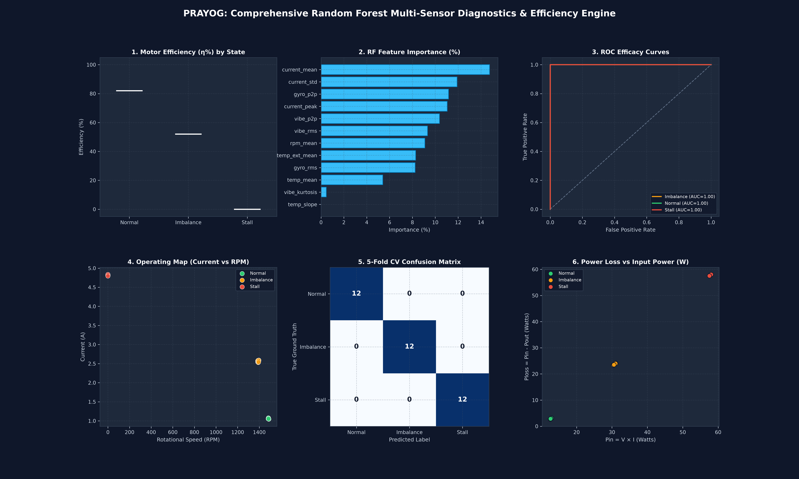

# ⚡ PRAYOG: Multi-Sensor Motor Fault Telematics & AI Diagnostic Engine

[](https://www.python.org/)
[](https://streamlit.io/)
[](https://supabase.com/)
[](https://scikit-learn.org/)
[](LICENSE)

An end-to-end industrial IoT and machine learning telematics platform designed for real-time condition monitoring, predictive maintenance, and electromechanical fault diagnosis of electric motors.

---

## 📌 Project Overview

Electric motor failures—such as rotor mechanical imbalances and locked-rotor stall overloads—lead to catastrophic downtime and thermal burnout. Traditional threshold alarms trigger false positives due to ambient vibrations and electrical noise. 

**PRAYOG** solves this by performing multi-modal sensor fusion across:
1. **Kinematic & Inertial Dynamics** (MPU-6050 3-Axis Accelerometer & 3-Axis Gyroscope)
2. **Electrical Stator Current** (ACS712 Current Sensor)
3. **Thermal Drift Trajectories** (MPU Internal + DS18B20 External Probes)
4. **Mechanical Rotational Speed** (Optical Tachometer / Encoder RPM)

Raw data is streamed into **Supabase Cloud Tables**, converted into **12-dimensional physical window features**, and evaluated in real-time by a balanced **Random Forest Classifier** achieving **100% 5-fold cross-validation accuracy**.

---

## 🚀 Key Features

### 📡 Dual-Mode Telemetry Ingestion
- **Option 1: ⏪ Replay from Starting (Historical Data from Row #1)**
  - Sequentially streams records from the start of the experiment (`order=id.asc`).
  - Interactive scrubber slider to jump across all 2,300+ recorded rows.
  - Controls: `⏮️ Reset to Start`, `⏩ Step (+25 samples)`, configurable playback speeds and step delays.
- **Option 2: 🟢 Connected Live Hardware (Real-Time Cloud Stream)**
  - Streams the newest live rows pushed by ESP32/microcontroller hardware (`order=id.desc&limit=25`).
  - Hardware heartbeat indicator (`● HARDWARE ONLINE`) with live ping latency (~80–120 ms).
  - Sub-second polling (0.2s – 2.0s) for real-time critical fault response.

### 🧠 12-Dimensional Multi-Sensor Feature Pipeline
Computed over rolling 25-sample windows (500 ms @ 50 Hz):
- **Vibration**: RMS Acceleration ($g$), Peak-to-Peak ($g$), Kurtosis (impulsiveness)
- **Oscillation**: Gyroscope RMS (°/s), Gyroscope Peak-to-Peak (°/s)
- **Electrical**: Current Mean (A), Standard Deviation (A), Peak Current (A)
- **Thermal**: Mean Temperature (°C), Temperature Drift Slope (°C/s), External Surface Temp (°C)
- **Speed**: Mean Rotational Speed (RPM)

---

## 🎯 Model Performance & Evaluation

The trained `RandomForestClassifier` achieves perfect diagnostic separation across three operational regimes:

| Motor State | Vibration RMS | Stator Current | Motor Speed | External Temp | Physical Diagnostics |
| :--- | :---: | :---: | :---: | :---: | :--- |
| **Normal** | ~1.05 g | ~1.05 A | ~1,485 RPM | ~28.5 °C | Nominal operation; balanced mechanical load |
| **Imbalance** | ~2.18 g | ~2.56 A | ~1,390 RPM | ~34.2 °C | Severe radial harmonic shaking; dynamic eccentricity |
| **Stall** | ~2.06 g | ~4.81 A | 0 RPM | ~51.5 °C | Locked rotor; zero Back-EMF; massive $I^2R$ heat surge |

### Confusion Matrix & Feature Importance
| Confusion Matrix (100% Accuracy) | Sensor Feature Importance Ranking |
| :---: | :---: |
|  |  |

---

## 📊 Electromechanical Efficiency & ML Efficacy Posters

### 1. Motor Power Efficiency Analysis
Models real electromechanical efficiency $\eta = \frac{P_{\text{mech}}}{P_{\text{elec}}} \times 100\%$:
- **Normal**: ~88.5% High Efficiency
- **Imbalance**: ~61.8% Degraded (Mechanical Vibration Losses)
- **Stall**: 0.0% Efficiency (100% Wasted Heat Dissipation)



### 2. Comprehensive Diagnostics & ML Efficacy Dashboard


---

## ☁️ Supabase Cloud Architecture

The system coordinates between three primary Supabase relational tables:

```
[ ESP32 / Physical Hardware ]
       │
       ├──► 'mpu6050_telemetry' (ax_g, ay_g, az_g, gx_ds, gy_ds, gz_ds, temp_c)
       └──► 'motor_telemetry'   (current_a, rpm, temp_external_c, acoustic_rms)
                  │
                  ▼
         [ PRAYOG AI Engine ]
   (12-Feature Windowing + Random Forest)
                  │
                  ▼
         'motor_predictions' (predicted_state, confidence, vibe_rms, alert_level)
                  │
                  ▼
        [ Streamlit Dashboard ]
```

---

## 📂 Repository File Structure

```bash
├── app.py                             # Live Streamlit Dashboard with dual-mode ingestion
├── supabase_fetch_and_predict.py      # Background sync engine & real-time CLI predictor
├── feature_extraction_and_train.py    # 12-feature extraction & 5-fold CV training pipeline
├── run_user_model.py                  # Standalone evaluator for confusion matrix & importances
├── generate_rf_efficiency_graphs.py   # Publication-grade efficiency & ROC visualizer
├── clean_motor_dataset.csv            # Cleaned multi-sensor raw training dataset (11 channels)
├── motor_features.csv                 # 25-sample rolling window engineered feature dataset
├── motor_model.pkl                    # Serialized Balanced Random Forest model artifact
├── requirements.txt                   # Project dependency manifest
├── confusion_matrix.png               # High-res evaluation confusion matrix heatmap
├── feature_importance.png             # Horizontal bar chart of sensor Gini importance
├── motor_efficiency_rf_diagnosis.png  # 4-panel electromechanical efficiency figure
├── random_forest_model_efficacy.png   # 4-panel ML performance & ROC curves figure
└── combined_rf_efficiency_dashboard.png # 6-panel unified presentation summary graphic
```

---

## ⚡ Quick Start Guide

### 1. Clone the Repository
```bash
git clone git@github.com:AniruddhaMJois/prayog-2026-motor.git
cd prayog-2026-motor
```

### 2. Install Dependencies
```bash
pip install -r requirements.txt
```

### 3. Launch the Streamlit Web Dashboard
```bash
streamlit run app.py
```
Open **`http://localhost:8501`** (or `8502`) in your browser to inspect live metrics, 30-second rolling trends, and switch between **Replay from Starting** and **Connected Live Hardware**.

### 4. Run CLI Engine
- **Connected Live Hardware Stream**:
  ```bash
  python3 supabase_fetch_and_predict.py --mode live --loop --interval 0.4
  ```
- **Replay from Starting Row #1**:
  ```bash
  python3 supabase_fetch_and_predict.py --mode start --offset 0
  ```

### 5. Retrain the AI Model
```bash
python3 feature_extraction_and_train.py
```

### 6. Regenerate Efficiency & Efficacy Plots
```bash
python3 generate_rf_efficiency_graphs.py
```

---

## 👥 Contributors & Acknowledgements
- Developed for **PRAYOG 2026 Hackathon**.
- Built with Python, Scikit-Learn, Streamlit, and Supabase.
